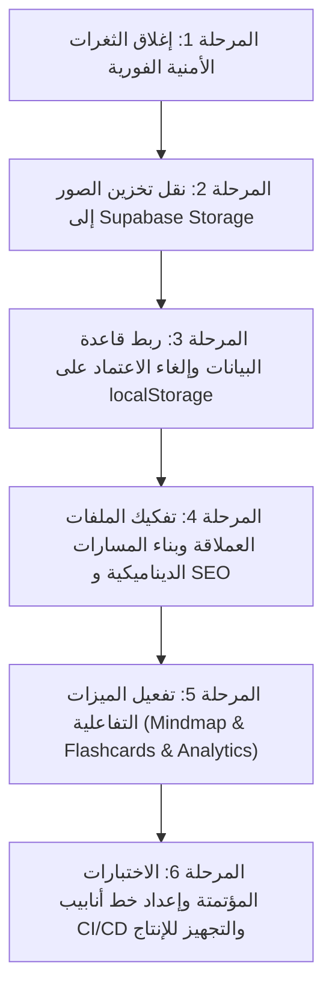

# تقرير التدقيق الفني الشامل وخريطة التطوير الاحترافي
## منصة دراسة حاسبات والمعلومات (FCI Study Platform)

---

## 1. الملخص التنفيذي (Executive Summary)

تم فحص ومراجعة مشروع **منصة دراسة حاسبات والمعلومات (Faculty of CS Platform)** فحصاً دقيقاً يشمل البنية المعمارية، قواعد البيانات، الأمان، الأداء، كفاءة الأكواد، وتجربة الاستخدام، ومقارنتها بالمواصفات الفنية الأصلية (`FCI_STUDY_PLATFORM_SPEC.md`).

### ما تم تنفيذه بنجاح وبشكل متميز:
1. **واجهة مستخدم عصرية وأنيقة:** تطبيق دقيق لنظام التصميم الداكن والفاتح (Dark/Light mode) مع لمسات الـ "Electric Lime"، ودعم ممتاز للغة العربية والاتجاه من اليمين لليسار (RTL-First) باستخدام الخصائص المنطقية في Tailwind CSS v4.
2. **طباعة متقنة:** تكامل الخطوط العربية الأصيلة (Cairo و Alexandria) مع خطوط الأكواد البرمجية (JetBrains Mono) بأسلوب يمنع تداخل النصوص ثنائية الاتجاه (BiDi wrapping).
3. **نواة ممتازة لخدمات المصادقة وقواعد البيانات:** توفير ملفات الهجرة (`supabase/migrations/`) مع إعدادات RLS وسياسات حماية متقدمة ودوال مساعدة.

### التحديات الجوهرية التي تمنع المشروع من أن يكون احترافياً وجاهزاً للإنتاج:
1. **انحراف معماري عن قاعدة البيانات:** لا يتم جلب المقررات أو المحاضرات من جداول Supabase، بل تعتمد الواجهة على ملف ثابت (`coursesData.ts`)، ويقوم لوحة الإدارة بحفظ التعديلات في `localStorage` الخاص بمتصفح المسؤول فقط، مما يعني أن الطلاب الآخرين لا يرون أي تحديثات!
2. **ثغرات أمنية حرجة:** وجود كلمات مرور سرية مكشوفة في الكود (Hardcoded Backdoors) واعتماد صلاحيات الإدارة على كوكي عادية غير موقعة، إضافة إلى غياب التحقق من صلاحيات المسؤول في دوال الخادم (Server Actions).
3. **تخزين الصور بصيغة Base64 في قاعدة البيانات:** رفع الصور كنصوص Base64 مباشرة في جداول Postgres، مما يستهلك الذاكرة ويؤدي لبطء استعلامات جداول المستخدمين ويفرض رفع حد حجم الطلبات إلى 10MB.
4. **ملفات عملاقة أحادية البنية (Monolithic Files):** وجود ملفات تتجاوز 1400 و 2000 سطر تجمع بين الرسم، والمنطق، وحالات النوافذ المنبثقة، وتشغيل الفيديو، والـ PDF، والاختبارات، مما يجعل الصيانة والتطوير مستقبلاً أمراً شاقاً.
5. **غياب المسارات الديناميكية (Dynamic Routing & SEO):** كل المحتوى موجود في صفحة واحدة `/courses` عبر حالات React التفاعلية، مما يمنع الطلاب من مشاركة رابط مباشر لمحاضرة معينة أو أرشفتها في محركات البحث.

---

## 2. التدقيق الأمني والثغرات الحرجة (Security Audit)

> [!CAUTION]
> هذه الثغرات يجب معالجتها فوراً قبل إطلاق المشروع للعامة، لأنها تسمح باختراق حسابات الإدارة والتلاعب ببيانات الطلاب.

### 2.1. كلمات مرور إدارة مكشوفة في الكود (Hardcoded Backdoor Passkeys)
- **الموقع:** `src/lib/actions/adminAuth.ts` (الأسطر 7 و 25-27)
- **المشكلة:**
  ```typescript
  const MASTER_ADMIN_SECRET = process.env.ADMIN_MASTER_SECRET || "fci-admin-secure-2025"
  if (passkey !== MASTER_ADMIN_SECRET && passkey !== "admin12345" && passkey !== "fci2025") { ... }
  ```
  أي مستخدم يكتب `"admin12345"` أو `"fci2025"` يحصل فوراً على صلاحيات مدير المنصة دون أي قيود!
- **الحل الاحترافي:**
  - إلغاء هذه الكلمات تماماً.
  - تعيين صلاحيات المدير (`admin`) يجب أن يتم فقط من خلال قاعدة البيانات مباشرة، أو عبر لوحة تحكم Supabase Dashboard، أو عبر كود دعوة أحادي الاستخدام مشفر بهاش قوي (Argon2 / Bcrypt) ومخزن بجدول آمن.

### 2.2. التحقق من صلاحيات الإدارة عبر كوكي قابلة للتزوير
- **الموقع:** `src/app/admin/page.tsx` و `src/lib/actions/adminAuth.ts`
- **المشكلة:**
  عند إدخال الرمز، يتم وضع كوكي عادية:
  ```typescript
  cookieStore.set("fci_admin_verified", "true", { ... })
  ```
  وفي صفحة الإدارة:
  ```typescript
  const hasAdminCookie = cookieStore.get("fci_admin_verified")?.value === "true"
  if (!isDatabaseAdmin && !hasAdminCookie) notFound()
  ```
  الاعتماد على كوكي نصية غير موقعة وغير مشفرة cryptographically يسمح لأي مستخدم بتعديل الكوكيز في متصفحه أو تجاوز التحقق إذا لم تكن هناك حماية إضافية.
- **الحل الاحترافي:**
  - الاعتماد حصرياً على رتبة المستخدم الحقيقية المخزنة في جدول `profiles.role = 'admin'` والمربوطة بالـ Session المشفرة لـ Supabase Auth.
  - التحقق داخل Middleware وعلى مستوى الـ Server Component.

### 2.3. غياب التحقق من صلاحيات المسؤول داخل دوال الخادم (Missing Authorization in Server Actions)
- **الموقع:** `src/lib/actions/adminMembers.ts` (`updateAdminMember`, `quickChangeMemberRole`, `deleteAdminMember`)
- **المشكلة:**
  الدوال تقبل المعاملات وتنفذ التعديل مباشرة على قاعدة البيانات دون التأكد من أن المستخدم صاحب الطلب يحمل رتبة `admin`:
  ```typescript
  export async function quickChangeMemberRole(memberId: string, newRole: UserRole) {
    const supabase = await createClient()
    const { error } = await supabase.from("profiles").update({ role: newRole }).eq("id", memberId)
    ...
  }
  ```
  أي مستخدم يعرف معرف الدالة يمكنه استدعاؤها برمجياً وترقية حسابه أو حذف أي طالب.
- **الحل الاحترافي:**
  إنشاء دالة مساعدة موحدة لحماية دوال الخادم:
  ```typescript
  async function assertAdmin() {
    const supabase = await createClient()
    const { data: { user } } = await supabase.auth.getUser()
    if (!user) throw new Error("غير مصرح: يرجى تسجيل الدخول")
    const { data: profile } = await supabase.from("profiles").select("role").eq("id", user.id).single()
    if (profile?.role !== "admin") throw new Error("غير مصرح: هذه العملية مخصصة لمدير المنصة فقط")
    return { supabase, user }
  }
  ```

### 2.4. ثغرة إعادة التوجيه المفتوح (Open Redirect Vulnerability)
- **الموقع:** `src/app/auth/callback/route.ts` (السطر 13)
- **المشكلة:**
  ```typescript
  const next = searchParams.get("next") ?? "/dashboard"
  ...
  return NextResponse.redirect(`${origin}${next}`)
  ```
  إذا مرر المهاجم `?next=//attacker.com` أو مسار خارجي، قد يؤدي ذلك لتوجيه الطالب لموقع تصيد احتيالي لسرقة بياناته.
- **الحل الاحترافي:**
  التحقق الصارم من أن الرابط يبدأ بـ `/` ولا يبدأ بـ `//` أو `/\`:
  ```typescript
  const safeNext = (next.startsWith("/") && !next.startsWith("//") && !next.startsWith("/\\")) 
    ? next 
    : "/dashboard";
  ```

### 2.5. دالة التعقيم Regex تشوه الأكواد البرمجية للطلاب
- **الموقع:** `src/lib/security.ts` في دالة `sanitizeInput`
- **المشكلة:**
  ```typescript
  export function sanitizeInput(input: unknown): string {
    ...
    .replace(/(--|\/\*|\*\/|;)/g, "")
  ```
  يتم استدعاء هذه الدالة عند حفظ ملاحظات الطلاب البرمجية في `StudentNotesWidget.tsx`. هذا يؤدي إلى **حذف الفواصل المنقوطة (`;`) وتعليقات الأكواد (`//`, `/* */`)** من كود لغات البرمجة (C++, Java, Python, JS)!
- **الحل الاحترافي:**
  - الاعتماد على الاستعلامات المجهزة تلقائياً (Parameterized Queries) التي يوفرها Supabase لمنع SQL Injection.
  - إيقاف نزع الرموز البرمجية من نصوص الطلاب، واستخدام مكتبة تنظيف العرض الآمن لمحتوى HTML مثل `DOMPurify` أو `rehype-sanitize` عند العرض فقط.

---

## 3. الخلل المعماري وقواعد البيانات (Architecture & Database Misalignments)

### 3.1. الاعتماد على `localStorage` و `coursesData.ts` بدلاً من Supabase DB
- **الوضع الحالي:**
  - جدول المقررات والمحاضرات والأسئلة مُعد ومبني بشكل ممتاز في ملفات الهجرة (`0002_tables.sql` و `0005_rpc.sql`).
  - ولكن واجهة التصفح (`CoursesExplorer.tsx`) تقرأ من ملف ثابت `coursesData.ts` ومصفوفة `allCourses`.
  - لوحة الإدارة (`AdminDashboard.tsx`) عند إضافة كورس أو محاضرة تحفظها في `localStorage.setItem("fci_admin_courses_v3", ...)`!
- **النتيجة:**
  - لا يمكن للطلاب رؤية المحتوى الذي يضيفه المشرفون.
  - في حال مسح المشرف لبيانات المتصفح، تضيع كل المقررات التي أنشأها.
  - تعطل الميزات المعتمدة على قاعدة البيانات (مثل تتبع التقدم `user_progress`، وسجل الاختبارات `quiz_attempts`).
- **الحل المطلوب:**
  - تفعيل سكربت استيراد المحتوى `scripts/import-content.ts` لنقل المقررات والمحاضرات من Markdown أو من واجهة الإدارة إلى جداول `courses` و `chapters` و `topics` و `resources` و `questions`.
  - ربط واجهات العرض باستعلامات قاعدة البيانات المباشرة مع استخدام الكاش الذكي في Next.js (ISR `revalidate = 3600`).

### 3.2. تخزين الصور كـ Base64 داخل نصوص جداول Postgres
- **الوضع الحالي:**
  - يتم تحويل الصورة في المتصفح إلى سلسلة Base64 ضخمة وإرسالها عبر Server Action (`profile.ts`) إلى جدول `user_avatars.image_data` و `profiles.avatar_url`.
  - تطلب ذلك زيادة حد حجم الـ Server Actions في `next.config.ts` إلى `10mb`.
- **المخاطر:**
  - استهلاك حجم قاعدة البيانات بسرعة وتدهور أداء الـ DB Memory Cache عند عمل `SELECT * FROM profiles`.
  - استهلاك عالي لبيانات الهاتف (Bandwidth Egress).
- **الحل الاحترافي:**
  - استخدام **Supabase Storage** بإنشاء باكت عام `avatars` مع سياسة أمان RLS تسمح للمستخدم برفع صورته فقط وحجم أقصى 2MB.
  - ضغط الصورة قبل الرفع إلى صيغة `WebP` خفيفة.
  - حفظ رابط الصورة (URL) فقط في حقل `avatar_url`.

### 3.3. تكرار وازدواجية الجداول في Migrations
- يوجد جدول ملاحظات في البداية: `notes` داخل `0002_tables.sql`.
- ثم تم إنشاء جدول جديد بالكامل: `student_notes` داخل `0007_student_notes_and_notifications.sql`.
- يجب دمج وتوحيد الجداول لتفادي التشتت وعدم ترابط البيانات.

---

## 4. هندسة الواجهات ومسارات Next.js (Routing, Structure & SEO)

### 4.1. تفكيك المكونات الأحادية العملاقة (De-monolithization)
حالياً، يحتوي المشروع على ملفات بالغة الضخامة:
- `src/components/admin/AdminDashboard.tsx` (2075 سطر!)
- `src/components/course/CoursesExplorer.tsx` (1420 سطر!)
- `src/components/notes/StudentNotesWidget.tsx` (763 سطر!)

**التأثير السلبي:**
- صعوبة التعديل واكتشاف الأخطاء.
- إعادة تصيير (Re-rendering) غير مبررة للواجهة كاملة عند تغيير حالة صغيرة.
- صعوبة كتابة اختبارات أحادية (Unit Tests).

**الهيكلة المقترحة:**
```
src/components/course/
├── CourseCard.tsx           # كارت المقرر الفردي
├── CourseHeader.tsx         # ترويسة المقرر والفرقة
├── ChapterAccordion.tsx     # قائمة فصول ومحاضرات المادة
├── LectureDetailView.tsx    # عرض تفاصيل المحاضرة
├── media/
│   ├── VideoPlayerModal.tsx # مشغل الفيديو المنفصل
│   ├── PdfViewerModal.tsx   # عارض ملفات PDF
│   └── RoadmapModal.tsx     # عارض الخرائط والمسارات
└── quiz/
    ├── LectureQuizModal.tsx # نافذة الاختبار السريع
    └── QuizQuestionItem.tsx # عنصر السؤال والخيارات
```

### 4.2. تطبيق مسارات Next.js 15 App Router الكاملة
بدلاً من حشر كل الكورسات في `/courses` مع معاملات URL معقدة، يجب استخدام التوجيه الهرمي للمشروع:
- `/courses`: شبكة المقررات مع تصفية حسب الفرقة والترم.
- `/courses/[courseSlug]`: صفحة المقرر (نظرة عامة، فصول المنهج، نسبة الإنجاز).
- `/courses/[courseSlug]/[chapterSlug]/[topicSlug]`: صفحة الدرس أو المحاضرة (الشرح المنسق Markdown، الخريطة الذهنية، الفيديوهات، السلايدات، بنك الأسئلة).
- `/courses/[courseSlug]/practice`: بنك الأسئلة الشامل للمقرر مع إمكانية التصفية.
- `/quiz/[courseOrTopic]`: جلسة اختبار موقوتة.
- `/review`: مراجعة الكروت التعليمية بنظام التكرار المتباعد.

**فوائد هذا التحول:**
- **روابط مباشرة قابلة للمشاركة:** الطالب يستطيع إرسال رابط شرح محدد لزميله.
- **تحسين محركات البحث (SEO):** توليد ميتاداتا ديناميكية (`generateMetadata`) لكل مادة ومحاضرة، مما يجعل المنصة تظهر في نتائج بحث جوجل عند بحث الطلاب عن أسماء المواد ومحاضراتهم.
- **سرعة فائقة:** الاستفادة من التوليد المسبق الثابت (SSG / ISR) لصفحات المقررات دون الحاجة للاتصال بقاعدة البيانات في كل زيارة.

---

## 5. الأداء وسرعة التحميل (Performance & Core Web Vitals)

### 5.1. إزالة التحميل المزدوج للخطوط
- في `src/app/layout.tsx`: يتم تحميل الخطوط عبر `next/font/google` (`alexandria`, `cairo`, `jetbrainsMono`).
- وفي `src/app/globals.css` (السطر 1):
  ```css
  @import url('https://fonts.googleapis.com/css2?family=Alexandria:wght@300;400;500;600;700;800;900&family=Cairo:wght@400;600;700;800;900&display=swap');
  ```
- **المشكلة:** متصفح المستخدم يقوم بتحميل الخطوط مرتين، كما أن `@import` داخل CSS يعطل سرعة التحميل الأولية (Render-blocking).
- **الحل:** حذف السطر `@import` من `globals.css` والاعتماد التام على `next/font/google` المحسنة تلقائياً.

### 5.2. التحميل الكسول للمكونات الثقيلة (Dynamic Imports & Lazy Loading)
- مشغلات الفيديو والـ PDF والخرائط يجب ألا تُحمّل مع حزمة الصفحة الرئيسية (Bundle).
- استخدام `React.lazy` أو `next/dynamic`:
  ```typescript
  const PdfViewer = dynamic(() => import('@/components/course/media/PdfViewerModal'), { ssr: false })
  const MindMap = dynamic(() => import('@/components/topic/MindMapView'), { ssr: false })
  ```

### 5.3. استغلال ميزة Next.js `<Image />`
استبدال علامات `` العادية بمكون `next/image` لدعم:
- التحويل التلقائي لصيغ `WebP` و `AVIF`.
- الحجم المتجاوب حسب شاشة الهاتف.
- منع الـ Layout Shift (CLS).

---

## 6. ميزات الجودة الأكاديمية المفقودة (Missing Academic Features)

للارتقاء بالمشروع إلى منصة أكاديمية احترافية رائدة لطلاب حاسبات:

### 6.1. الخرائط الذهنية التفاعلية (Markmap Interactive Mindmaps)
- تم التخطيط لها في المواصفات باستخدام مكتبتي `markmap-lib` و `markmap-view`.
- تتيح للطالب استيعاب شجرة المفاهيم المعقدة (مثل أنواع هياكل البيانات أو خوارزميات الترتيب) بصرياً مع إمكانية التكبير والتصغير وتنزيل الخريطة كصورة SVG.

### 6.2. نظام التكرار المتباعد للبطاقات التعليمية (Spaced Repetition / Flashcards)
- تطبيق خوارزمية التكرار (مثل SM-2 أو نظام Leitner) المجهزة مسبقاً في دالة الخادم `review_flashcard` في هجرة `0005_rpc.sql`.
- يساعد الطلاب على تثبيت المفاهيم والمصطلحات قبل الامتحانات دون نسيان.

### 6.3. محرك تحليل نقاط الضعف في الاختبارات (Weakness Analytics)
- عند إنهاء الطالب للاختبار، يتم تسجيل الإجابات في `quiz_attempts`.
- يقوم النظام بعرض الموضوعات التي أخطأ فيها الطالب في لوحة التحكم الشخصية (`/dashboard`) مع روابط مباشرة لإعادة دراستها.

### 6.4. دعم المذاكرة دون إنترنت (PWA & Offline Reading)
- نظراً لظروف انقطاع الإنترنت أو بطئه أحياناً لدى الطلاب، فإن تحويل المنصة إلى **Progressive Web App (PWA)** مع تخزين الملاحظات ومحاضرات المادة المختارة محلياً عبر Service Workers سيعطي المنصة قيمة استثنائية.

---

## 7. الجودة البرمجية، الاختبارات والـ CI/CD (Testing & Reliability)

1. **انعدام الاختبارات الآلية (Zero Automated Tests):**
   - لا توجد اختبارات وحدة (Unit Tests) للمنطق البرمجي، ولا اختبارات واجهات (E2E Tests).
   - **المطلوب:**
     - إعداد **Vitest** لاختبار أدوات التعقيم، والتحقق، وعمليات حساب نتائج الاختبارات.
     - إعداد **Playwright** لاختبار رحلة المستخدم الأساسية (تسجيل الدخول، استعراض مقرر، حل اختبار، تدوين ملاحظة).
2. **غياب خط أنابيب التكامل المستمر (CI Pipeline):**
   - يجب إضافة ملف `.github/workflows/ci.yml` ليقوم بفحص الكود تلقائياً عند كل Pull Request أو Commit:
     ```yaml
     name: CI
     on: [push, pull_request]
     jobs:
       verify:
         runs-on: ubuntu-latest
         steps:
           - uses: actions/checkout@v4
           - uses: pnpm/action-setup@v3
           - uses: actions/setup-node@v4
             with:
               node-version: 20
               cache: 'pnpm'
           - run: pnpm install --frozen-lockfile
           - run: pnpm typecheck
           - run: pnpm lint
           - run: pnpm test
           - run: pnpm build
     ```
3. **التخلص من الـ `any` الزائد في أكواد TypeScript:**
   - يوجد أكثر من 20 موضعاً في المشروع يستخدم `eslint-disable-next-line @typescript-eslint/no-explicit-any`.
   - استخدام الـ Types الصادرة تلقائياً من Supabase (`Database['public']['Tables']['...']`) يعطي حماية كاملة ضد أخطاء runtime.

---

## 8. خريطة الطريق التنفيذية (Actionable Roadmap)



| المرحلة | المهام التفصيلية | الأولوية |
|---|---|---|
| **1. الأمان والحماية** | • إزالة كلمات المرور المكشوفة (`admin12345`, `fci2025`).<br>• تأمين دوال الخادم بالتحقق الصارم من دور `admin`.<br>• منع ثغرة Open Redirect في مسار المصادقة.<br>• تعديل دالة التعقيم لمنع تشويه الأكواد البرمجية. | 🔴 حرجة وعاجلة |
| **2. الوسائط والتخزين** | • إنشاء Supabase Storage Bucket `avatars`.<br>• نقل رفع الصور من نصوص Base64 إلى روابط CDN مباشرة.<br>• إعادة ضبط حجم طلبات Server Actions في `next.config.ts`. | 🟠 عالية جداً |
| **3. البيانات والمزامنة** | • تفعيل خط أنابيب المحتوى في Supabase DB.<br>• إلغاء حفظ المقررات في `localStorage` للمسؤول.<br>• ربط واجهة المقررات ولوحة الإدارة بقاعدة البيانات المشتركة.<br>• توحيد جدولي الملاحظات `notes` و `student_notes`. | 🟠 عالية جداً |
| **4. المعمارية و SEO** | • تفكيك المكونات الأحادية (`AdminDashboard`, `CoursesExplorer`).<br>• إنشاء المسارات الديناميكية `/courses/[courseSlug]/[topicSlug]`.<br>• إضافة ميتاداتا ديناميكية و OpenGraph لكل مادة.<br>• إزالة التحميل المزدوج للخطوط وتسريع وقت العرض الأول (FCP). | 🟡 عالية |
| **5. الميزات الأكاديمية** | • دمج الخرائط الذهنية التفاعلية عبر `markmap`.<br>• تفعيل نظام التكرار المتباعد للبطاقات (Spaced Repetition).<br>• تفعيل محرك تسجيل المحاولات وتحليل نقاط الضعف.<br>• دعم PWA للمذاكرة والتصفح بدون إنترنت. | 🟢 متوسطة |
| **6. الاختبارات والإنتاج** | • كتابة اختبارات Vitest للوحدات البرمجية.<br>• كتابة اختبارات Playwright لمسار المستخدم الحرج.<br>• إنشاء GitHub Actions CI Pipeline.<br>• إعداد نظام مراقبة الأخطاء في الإنتاج (Sentry). | 🟢 جودة واستدامة |

---

## 9. الخلاصة والتوصية

مشروع **FCI Study Platform** يمتلك أساساً فائق الجمال والتميز من حيث الفكرة، والتصميم البصري، ودعم اللغة العربية. بتطبيق التحسينات الأمنية العاجلة الموضحة في هذا التقرير، وربط الواجهات بجداول قاعدة البيانات الموجودة بالفعل بدلاً من التخزين المؤقت المحلي، سينتقل المشروع مباشرة من مرحلة "النموذج الأولي" إلى مصاف **المنصات التعليمية الاحترافية عالمية المستوى**.

